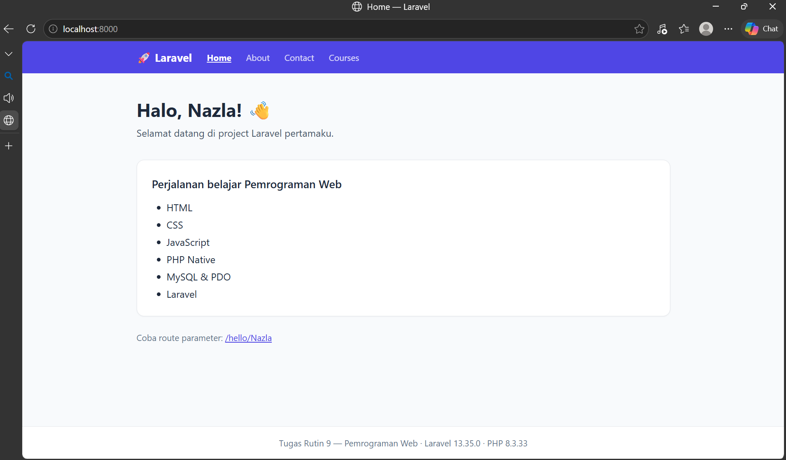
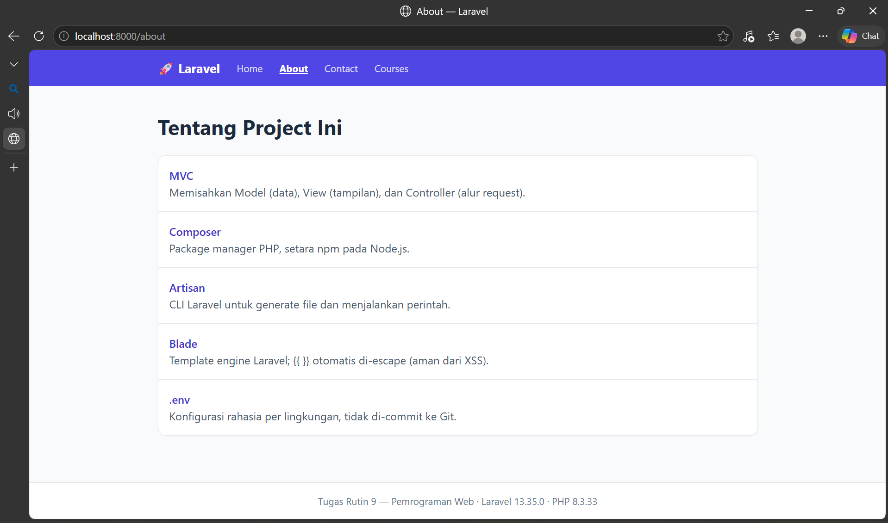
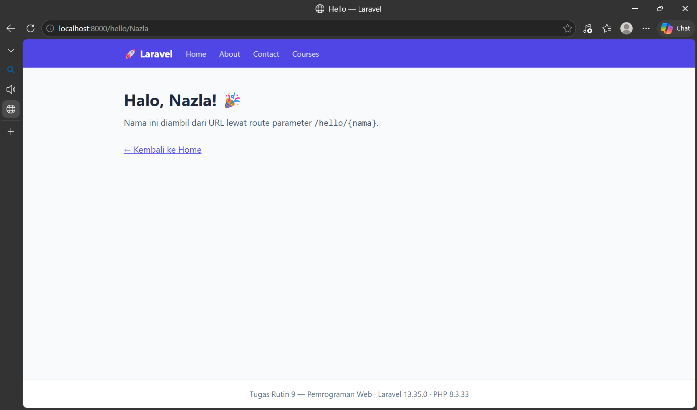

# Tugas Rutin 9 — Setup Laravel
**Pemrograman Web - Nazla**

Repo: TugasWeb-P9-LaravelSetup

## 📌 Deskripsi
Project Laravel pertama untuk memenuhi Tugas Pertemuan 9. Menampilkan 3 route custom, data dinamis, controller, model, dan route parameter bonus `/hello/{nama}`.

## 📸 Screenshot Hasil

### Home Page `/`

### About Page `/about`

### Bonus Route Parameter `/hello/Nazla`

## ✅ Requirements Terpenuhi
1. Install Composer & `composer create-project laravel/laravel`
2. Buat DB di phpMyAdmin `tugasweb_p9` & konfigurasi `.env` (DB_DATABASE, DB_USERNAME, DB_PASSWORD)
3. `php artisan serve` berjalan di `http://localhost:8000` + screenshot (Halo, Nazla!)
4. 3 route custom: `/` (home), `/about`, `/contact` return Blade view
5. View menampilkan data dinamis (array `$courses` dari route)
6. `php artisan make:controller PageController` & `php artisan make:model Course -m`
7. Bonus: styling Tailwind CDN + route parameter `/hello/{nama}` -> `Halo, Nazla!`

## 🚀 Langkah Install (di laptop dosen / teman)
1. Clone repo:git clone https://github.com/username/TugasWeb-P9-LaravelSetup.git
   cd TugasWeb-P9-LaravelSetupjavascript2. Install dependency:composer install
   npm installjavascript3. Copy .env:cp .env.example .env
   php artisan key:generatejavascript4. Setting DB di `.env`:DB_CONNECTION=mysql
   DB_DATABASE=tugasweb_p9
   DB_USERNAME=root
   DB_PASSWORD=javascript5. Buat DB `tugasweb_p9` di phpMyAdmin
6. Migrasi & Seeder:php artisan migrate:fresh --seedjavascript7. Jalanin:php artisan servejavascript   Buka http://localhost:8000

## 📁 Penjelasan Struktur Folder Laravel
- `app/Http/Controllers` -> Tempat Controller (logika route, contoh: PageController)
- `app/Models` -> Model Eloquent (representasi tabel DB, contoh: Course.php)
- `routes/web.php` -> Definisi semua route web (/, /about, /hello/{nama})
- `resources/views` -> File Blade (tampilan HTML: home.blade.php, about.blade.php, hello.blade.php, layouts/app.blade.php)
- `database/migrations` -> Struktur tabel (create_courses_table, create_enrollments_table)
- `database/seeders` -> Data awal (seeder courses)
- `public/` -> File yang bisa diakses publik
- `.env` -> Konfigurasi DB & environment
- `README.md` -> Dokumentasi ini

## 🔗 Route List
- `/` -> Home (Halo, Nazla! + list perjalanan belajar)
- `/about` -> About page
- `/contact` -> Contact page
- `/hello/{nama}` -> Bonus route parameter (contoh: /hello/Nazla)
- `/courses` -> List courses dari DB

## 👩‍💻 Dibuat oleh
Nazla - Tugas Rutin 9 Pemrograman Web